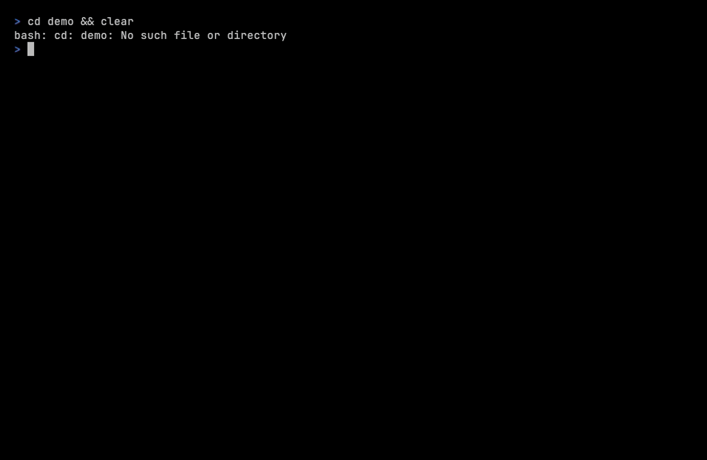

<p align="center">
  
</p>

<h1 align="center">zlrd</h1>

<p align="center">
  <strong>Read your logs fast. Know when a service dies.</strong><br/>
  A terminal log viewer that doubles as a crash watcher — panics go straight
  to Telegram or Slack,<br/>and the history stays on the box.<br/>
  Built in Zig. One static binary. No agent, no database, no stack to run.
</p>

<p align="center">
  <a href="https://github.com/alaleks/zlrd/releases"></a>
  <a href="https://github.com/alaleks/zlrd/actions/workflows/ci.yml"></a>
  <a href="https://github.com/alaleks/zlrd/actions/workflows/release.yml"></a>
  <a href="https://ziglang.org"></a>
  <a href="LICENSE"></a>
</p>

<p align="center">
  
</p>

---

## Why zlrd

If you already run Loki, Datadog or a Prometheus stack, use them — they are
better at this than a 1.6 MB binary can be.

`zlrd` is for the other case. One box. A handful of services. No room for an
observability stack, and no appetite for running one. You still need to know
that the API died at three in the morning, and why.

So it does two things, in one static binary you copy onto the host:

**Reads logs fast.** Streams multi-GB files in constant memory, auto-detects
JSON / `[LEVEL]` / logfmt, filters by level, regex, date and time window,
follows like `tail -F`, and reads `.log.gz` without unpacking.

**Watches services.** Recognises a panic from Go, Rust, Python, Java, C/C++
or a pattern of your own, captures the stack trace that follows it, tells a
crash from a restart, and sends you the whole thing.

### What that looks like

```bash
zlrd --agent \
     --service api=/var/log/api.log \
     --alert-telegram="$BOT_TOKEN:$CHAT_ID" \
     /var/log/api.log
```

That is the whole setup. No scrape target, no Alertmanager, no templating
proxy, no sidecar container. When the service panics, this lands in your
chat:

    🔴 api crashed
    go_panic · /var/log/api.log · pid 4192
    panic: runtime error: invalid memory address or nil pointer dereference

        goroutine 1 [running]:
        main.(*Server).handle(0x0, {0x14000112000, 0x1f})
                /src/api/server.go:142 +0x24
        main.main()
                /src/api/main.go:31 +0x88

    crashes: 3 · restarts: 1

And in the morning, without anything having to still be running:

```console
$ zlrd status

SERVICE  CRASHES  RESTARTS  LAST CRASH
api            3         1  4h ago   go_panic
worker         0         2  -

last crash api · 4h ago (2026-09-06 03:12:44 UTC)
  panic: runtime error: invalid memory address or nil pointer dereference
  goroutine 1 [running]:
  main.(*Server).handle(0x0, {0x14000112000, 0x1f})
      /src/api/server.go:142 +0x24
```

There *is* a Prometheus endpoint, and it is a good one — but it is
[opt-in](#optional-prometheus-endpoint) and off until you ask for it, because
the whole point is that you probably don't have a Prometheus.

### Instead of

| You used to run                                          | With `zlrd`                                                    |
| -------------------------------------------------------- | -------------------------------------------------------------- |
| `tail -F app.log \| grep -i error`                       | `zlrd -tl error app.log`                                       |
| `zcat app.log.gz \| jq 'select(.level=="error")'`        | `zlrd -l error --output json app.log.gz \| jq .`               |
| `awk '/ERROR/{n++} END{print n}'` over a window          | `zlrd --agent --alert-error-rate=10/60s app.log`               |
| a cron job grepping for `panic:` + a `curl` into Slack   | `zlrd --agent --service api=app.log --alert-slack=$URL`        |
| "did it crash last night?" → SSH, `less`, scroll         | `zlrd status`                                                  |
| Alertmanager + a templating proxy for a chat message     | `--alert-telegram` / `--alert-slack` / `--alert-discord`       |

---

## Table of contents

- [Highlights](#highlights)
- [Benchmarks](#benchmarks)
- [Installation](#installation)
- [Reading logs](#reading-logs)
  - [Examples](#reader-examples)
  - [Supported log formats](#supported-log-formats)
  - [Relative windows](#relative-windows)
  - [Aggregation modes](#aggregation-modes)
- [Watching services](#watching-services)
  - [Quick start](#agent-quick-start)
  - [Config file](#config-file)
  - [How it fits together](#how-it-fits-together)
  - [Service crash tracking](#service-crash-tracking)
  - [Chat alerts: Telegram, Slack, Discord](#chat-alerts-telegram-slack-discord)
  - [State that survives a restart](#state-that-survives-a-restart)
  - [Alert rules](#alert-rules)
  - [Alert sinks](#alert-sinks)
  - [systemd journal sources](#systemd-journal-sources)
  - [Kernel-level probes](#kernel-level-probes)
  - [Webhook integration](#webhook-integration)
  - [Sidecar: OTLP export](#sidecar-otlp-export)
  - [Optional: Prometheus endpoint](#optional-prometheus-endpoint)
  - [Production deployment](#production-deployment)
- [CLI reference](#cli-reference)
- [Roadmap](#roadmap)
  - [Status](#status)
  - [Prior art](#prior-art)
- [Contributing](#contributing)
- [License](#license)

---

## Highlights

**Reader**

- **Streaming** — line-by-line, constant memory, multi-GB files
- **SIMD-accelerated** parsing of JSON / `[LEVEL]` / `level=` logfmt
- **Filtering** — level, date range, time-of-day window, regex (`|` and `&`),
  and `--since 5m` relative to the log's own newest record
- **Tail mode** — a drop-in `tail -F` that keeps the filtering
- **Aggregation** — group identical, normalized, or message-keyed lines
- **Nested payloads** — JSON *and* protobuf inside a log message, expanded
  and highlighted in place
- **Parallel scan** — seekable files split at line boundaries across cores,
  output byte-identical to the serial path
- **Compressed input** — read `.log.gz` directly, no temp files
- **JSONL output** for clean piping into `jq`

**Watcher** (`--agent`)

- **Crash tracking per service** — Go, Rust, Python, Java, C/C++, shell, or
  your own `--crash-marker`, with the stack trace captured whole
- **Stop vs. restart** — told apart by inode change and silence windows, no
  PID guessing
- **Alerts into chat** — native Telegram, Slack and Discord bodies, no
  templating proxy in between
- **State that survives a restart** — counters, last crash and its trace,
  read back with `zlrd status`
- **Alert rules** — error-rate, regex-rate, first-seen signature, silence
- **Webhooks that don't lose alerts** — retries with backoff, an on-disk
  spool across restarts, HMAC-signed bodies, a `host` field for fleets
- **Config file** — the whole command line as TOML, flags override it
- **systemd-journal sources** (`--journal-unit`), read natively — no
  `journalctl` subprocess
- **Kernel-level probes** — OOM, segfault, prior-boot panic; eBPF when built
  with `-Dwith-ebpf=true`
- **Prometheus `/metrics`** if you already have a scraper — opt-in, off by
  default

**Everywhere**

- **Single static binary** — no runtime, no glibc, no surprises
- **Zero third-party dependencies** — regex engine, gzip, HTTP server,
  protobuf and journal readers are all in-tree Zig

---

## Benchmarks

Reproduce with `bench/vs-tools.sh` — it generates its own fixtures and prints
every command as it runs. Numbers below: Apple M5, 40.4 MB / 400k lines of
mixed JSON + bracketed + logfmt, best of 5 warm runs.

Two things keep this honest. Output goes to a **file, never `/dev/null`** —
GNU grep checks for `/dev/null` and stops at the first match like `-q`, which
is how the first draft of this table had it at 32 GB/s. And every row reports
the **number of lines the command actually produced**, so a tool that errors
out or matches nothing cannot hide behind a fast time.

**Filtering by level — the thing zlrd is for**

| Tool | Time | Errors found | |
| --- | --- | --- | --- |
| `grep '"level":"error"'` | 32 ms | 22 298 | matches one spelling, in one format |
| `jq 'select(.level=="error")'` | — | **fails** | aborts on the first non-JSON line |
| `zlrd -l error` | **27 ms** | **66 787** | reads the level from all three formats |

Three times the errors out of the same file. `grep` only sees the ones written
as JSON; the other two thirds are `[ERROR]` and `level=error`.

**The same task on pure JSONL, where `jq` can compete**

All three emit one JSON object per matching record — 22 298 each, so the work
really is identical.

| Tool | Time | Throughput |
| --- | --- | --- |
| `jq 'select(.level=="error")'` | 269 ms | 79 MB/s |
| `zlrd -l error --output json` | **21 ms** | **1010 MB/s** |
| `grep '"level":"error"'` | 25 ms | 848 MB/s (substring, not a parse) |

**Grouping repeated messages** — 17.2 MB, 160 distinct lines; all three report
160 groups.

| Tool | Time | |
| --- | --- | --- |
| `sort \| uniq -c \| sort -rn` | 331 ms | sorts the whole file |
| `awk '{c[$0]++} ...'` | 262 ms | hash table — same algorithm |
| `zlrd -a` | **28 ms** | hashes as it streams |

**Plain substring search** — the case `grep` is built for.

| Tool | Time | |
| --- | --- | --- |
| `zlrd -s` | **23 ms** | also detects the format of each line it prints |
| GNU `grep` | 44 ms | |

`ripgrep` is not in the table because it was not installed on the machine that
produced this run — the script prints its row when it is present. Expect it to
land near `grep` or below on a task this simple.

**Where zlrd is slower**

Reading a `.gz`: `gzcat \| grep` takes 39 ms, `zlrd` 92 ms. The decoder is not
the problem — zlrd's inflate runs about 39 ms against zlib's 34 ms on the same
data. The gap is that the shell pipeline decompresses and searches in two
processes on two cores, while zlrd does both on one thread.

Reading and rendering the whole file: `cat` 25 ms, `zlrd` 34 ms — and `cat`
does no parsing at all, while zlrd formats all 400 000 records. `wc -l`, which
only counts newlines, takes 45 ms.

Compressed input is the one row left where a shell pipeline wins outright, and
the reason is the same one that makes everything else fast: `gzcat | grep`
decompresses and searches in two processes on two cores. A `.gz` cannot be
split at line boundaries without decompressing it first, so the parallel scan
has nothing to work with there.

**Why the numbers above beat single-threaded tools by more than a constant**

`grep`, `less`, `awk` and `jq` are single-threaded, so seven of your eight
cores sit idle while one of them walks the file. zlrd splits a seekable input
at line boundaries, filters and formats the pieces in parallel, and writes
them back in the original order — the output is byte-for-byte identical to the
serial path, which is the only version of this worth shipping.

It turns itself off where it would change behaviour or cannot help: paginated
output (`-n`), aggregation (`-a`, which needs one table for the whole file),
`--tail`, compressed input, and files under 4 MB, where standing up the pool
costs more than the scan. Peak memory is bounded by the pool, not the file: a
worker blocks until the writer has taken its buffer, so at most one chunk per
thread is ever in flight.

`ripgrep` is still the right tool when the question is purely about bytes.
zlrd earns its time when the question is about *log structure* — levels, time
windows, repeated messages, crash markers — and it no longer costs you
throughput to ask.

**The agent over a day and a half**

`zlrd agent` following one log on a 1-vCPU Linux 6.8 x86_64 VM (ReleaseFast,
musl) for 32.6 hours, at ~6 000 lines/s, with the file rotated every 10
minutes through all four kinds below. RSS, fds and threads sampled every
minute.

| | |
| --- | --- |
| Lines written / counted by the agent | 704 457 011 / 704 457 011 — none lost or doubled |
| Rotations followed | 195 |
| RSS | 1.9 MB at start, 2.72 MB from hour 11.5 to the end — flat for the last 21 h and ~455 M lines |
| Open fds / threads | 6–7 / 3 the whole run |

Rotation on its own — 105 000 numbered lines through 20 rotations of each
kind, read by both `zlrd -t` and the agent: `mv` + create, `copytruncate`,
delete + recreate, `mv` + gzip. Every line arrived exactly once in every mode.

Bad input — 1 MiB lines, 32 MiB of random bytes, broken JSON, mixed formats
with CRLF and NUL, a file that appears only after start: the reader exits 0
and peaks at 2.5 MB, and the agent stays up, counts every line and peaks at
2.1 MB.

---

## Installation

Two flavours are published for every release:

| Binary        | Size (rel.) | Includes                                            | For you if…                                                              |
| ------------- | ----------- | --------------------------------------------------- | ------------------------------------------------------------------------ |
| **`zlrd`**    | full        | reader **+ agent + sidecar + journal + kernel**     | You want `/metrics`, alerts, webhooks, journal sources, kernel probes    |
| **`zlrd-lite`** | ~60 % smaller | reader only (filter, tail, colorize, aggregate) | You only need a fast `tail`/`grep` replacement in the terminal           |

Both binaries share the reader, so `zlrd-lite app.log` and `zlrd app.log`
behave identically. `zlrd-lite --agent` prints an error pointing at the full
binary instead of silently doing nothing.

### macOS — Homebrew

```bash
# Full binary (reader + agent + sidecar)
brew install alaleks/tap/zlrd

# Lightweight reader-only build
brew install alaleks/tap/zlrd-lite
```

### Linux — apt (Debian, Ubuntu)

```bash
# 1. Prerequisites (skip if you already have curl and gpg)
sudo apt update && sudo apt install -y curl gpg

# 2. Import the registry signing key
curl -fsSL "https://packages.buildkite.com/aleksandr-aleksandrov/zlrd/gpgkey" \
  | sudo gpg --dearmor -o /etc/apt/keyrings/aleksandr-aleksandrov_zlrd-archive-keyring.gpg

# 3. Add the apt source
echo "deb [signed-by=/etc/apt/keyrings/aleksandr-aleksandrov_zlrd-archive-keyring.gpg] https://packages.buildkite.com/aleksandr-aleksandrov/zlrd/any/ any main" \
  | sudo tee /etc/apt/sources.list.d/buildkite-aleksandr-aleksandrov-zlrd.list > /dev/null

# 4. Install one (or both — they don't conflict, different binary names)
sudo apt update && sudo apt install zlrd          # full
sudo apt install zlrd-lite                        # reader-only
```

### Pre-built binaries

Download the archive for your platform from
[Releases](https://github.com/alaleks/zlrd/releases/latest) and put the
binary on your `PATH`.

| Platform              | Full (`zlrd`)                     | Lite (`zlrd-lite`)                     |
| --------------------- | --------------------------------- | -------------------------------------- |
| macOS Apple Silicon   | `zlrd-aarch64-macos.tar.gz`       | `zlrd-lite-aarch64-macos.tar.gz`       |
| macOS Intel           | `zlrd-x86_64-macos.tar.gz`        | `zlrd-lite-x86_64-macos.tar.gz`        |
| Linux x86_64          | `zlrd-x86_64-linux.tar.gz`        | `zlrd-lite-x86_64-linux.tar.gz`        |
| Windows x86_64        | `zlrd-x86_64-windows.zip`         | `zlrd-lite-x86_64-windows.zip`         |

Every release also ships `checksums.txt` with SHA-256 hashes for all
archives and `.deb` packages.

One-liner install on Unix-like systems:

```bash
# macOS Apple Silicon — full
curl -fsSL https://github.com/alaleks/zlrd/releases/latest/download/zlrd-aarch64-macos.tar.gz \
  | tar xz && sudo mv zlrd /usr/local/bin/

# macOS Apple Silicon — lite
curl -fsSL https://github.com/alaleks/zlrd/releases/latest/download/zlrd-lite-aarch64-macos.tar.gz \
  | tar xz && sudo mv zlrd-lite /usr/local/bin/

# Linux x86_64 — full
curl -fsSL https://github.com/alaleks/zlrd/releases/latest/download/zlrd-x86_64-linux.tar.gz \
  | tar xz && sudo mv zlrd /usr/local/bin/

# Linux x86_64 — lite
curl -fsSL https://github.com/alaleks/zlrd/releases/latest/download/zlrd-lite-x86_64-linux.tar.gz \
  | tar xz && sudo mv zlrd-lite /usr/local/bin/
```

### From source

Requires Zig **0.17.0** or later.

```bash
git clone https://github.com/alaleks/zlrd.git
cd zlrd
zig build -Doptimize=ReleaseFast

# Both binaries land in zig-out/bin
sudo install zig-out/bin/zlrd      /usr/local/bin/
sudo install zig-out/bin/zlrd-lite /usr/local/bin/
```

---

## Reading logs

The default mode: read, filter, paginate, follow.

```
zlrd [options] <file...>
```

If no file is passed, `zlrd` reads every `*.log` and `*.log.gz` in the current
directory.

### Reader examples

```bash
# Stream a file with default formatting
zlrd app.log

# Filter by level
zlrd -l error,warn app.log

# Search with OR / AND operators
zlrd -s "connection|timeout" app.log
zlrd -s "error&database"     app.log

# Date range
zlrd -d 2024-01-01..2024-01-31 app.log

# Time window inside one day (incident drill-down)
zlrd -d 2024-01-20 --from 09:00 --to 09:30 app.log

# The last five minutes of the log
zlrd --since 5m app.log

# Real-time follow, errors only
zlrd -t -l error app.log

# Aggregate normalized lines (strips IDs, timestamps, digits)
zlrd -a -m normalized app.log

# Pipe to jq
zlrd --output json app.log | jq 'select(.level == "error")'

# Multiple files with combined filters
zlrd -l error -d 2024-01-20 -s "timeout" app.log gateway.log

# GNU-style grouped short flags
zlrd -tl error app.log
```

### Supported log formats

`zlrd` auto-detects the format from the line shape.

**JSON**

```
{"time":"2024-01-20T12:00:00Z","level":"error","message":"connection refused"}
```

**Bracketed plain text**

```
[ERROR] connection refused
```

**logfmt**

```
time=2024-01-20T12:00:00Z level=error msg="connection refused"
```

Recognized level keys: `level`, `severity`, `lvl`. Recognized timestamp keys:
`time`, `timestamp`, `date`.

### Relative windows

`--since` takes `5m`, `90s`, `2h`, `7d`, or a bare number of seconds, and
keeps the records inside that window.

The window is measured **from the newest timestamp in the input**, not from
the wall clock. That is a deliberate departure from `journalctl --since`, and
it buys two things. It is immune to time zones — both sides of the comparison
come from the same log, so whatever offset its timestamps carry cancels out,
and the machine reading the file never has to agree with the one that wrote
it. And `zlrd --since 5m` on a log rotated last week shows the last five
minutes *of that log*, where a wall-clock window would print nothing at all.

Lines with no timestamp — stack frames, continuation lines, banners — are
kept. They belong to the record above them, and dropping them would shred
exactly the entries the window was opened to read.

Compressed inputs are skipped when looking for the anchor: a `.gz` is not
seekable, so its tail cannot be read without decompressing everything ahead
of it. With only `.gz` files on the command line and nothing else to anchor
on, `--since` does nothing rather than guessing.

### Aggregation modes

| Mode             | Groups by                                     | Use case                          |
| ---------------- | --------------------------------------------- | --------------------------------- |
| `exact`          | full line                                     | Count identical lines             |
| `level-message`  | level + extracted message                     | Same message, any timestamp       |
| `json-message`   | JSON `message`/`msg` field only               | Compare message text across runs  |
| `normalized`     | lowercased, digits → `#`, dates → `<date>`    | Find recurring error patterns     |

---

## Watching services

Point `zlrd --agent` at the log files your services write. It follows them
the way `tail -F` does, and on top of that it knows what a crash looks like:
it recognises panics and aborts from the common runtimes, captures the stack
trace underneath them, tells a crash apart from a routine restart, and sends
the result somewhere you will actually see it.

Everything below is implemented natively in Zig — no Prometheus client
library, no HTTP framework, no third-party deps — and nothing here needs a
collector, a database or a second process.

### Agent quick start

The smallest thing worth running:

```bash
zlrd --agent \
     --service api=/var/log/api.log \
     --alert-telegram="$BOT_TOKEN:$CHAT_ID" \
     /var/log/api.log
```

Step by step, that:

1. Follows `/var/log/api.log` from its current end.
2. Binds the name `api` to it, so events are about a *service* rather than
   about a path.
3. Watches every line for a crash marker — `panic:`, `fatal error:`,
   `Traceback (most recent call last):`, `thread '...' panicked at`, and the
   rest of the [built-in set](#what-counts-as-a-crash).
4. On a hit, collects the stack trace that follows and sends one message to
   your chat.
5. Writes what happened to the [state file](#state-that-survives-a-restart),
   so `zlrd status` can answer for it later.

No port is opened and no token is needed. Add `--alert-stderr` if you would
rather it went to the journal, or `--alert-file=/var/log/zlrd/alerts.jsonl`
for a JSONL record on disk.

Once that is in place, the rules are additive:

```bash
zlrd --agent \
     --service api=/var/log/api.log \
     --service gw=/var/log/gateway.log \
     --alert-slack="$SLACK_WEBHOOK" \
     --alert-error-rate=10/60s \
     --alert-regex='connection refused:5/60s' \
     --alert-first-seen \
     --alert-silence=120s \
     --alert-file=/var/log/zlrd/alerts.jsonl \
     --state=/var/lib/zlrd/state.json \
     /var/log/api.log /var/log/gateway.log
```

And if you *do* run Prometheus, one flag adds the endpoint — see
[Optional: Prometheus endpoint](#optional-prometheus-endpoint):

```bash
zlrd --agent ... --metrics-token=$(openssl rand -hex 16)
```

### Config file

A long command line can live in a TOML file instead. Keys are the long flag
names without `--`; a repeatable flag takes an array, a switch takes
`true`/`false`:

```toml
# /etc/zlrd/agent.toml
agent            = true
host-id          = "web-01"
file             = ["/var/log/api.log", "/var/log/gateway.log"]
service          = ["api=/var/log/api.log", "gw=/var/log/gateway.log"]
alert-error-rate = "10/60s"
alert-regex      = ["connection refused:5/60s"]
alert-first-seen = true
alert-telegram   = ["123456:AAH-token:-1001234567890"]
webhook-secret   = "change-me"
```

```bash
zlrd --config /etc/zlrd/agent.toml
zlrd --config /etc/zlrd/agent.toml --alert-error-rate=50/60s   # a flag wins
```

Anything given on the command line replaces the file's value — for a
repeatable flag the whole list, not one more entry. An unknown key or a value
of the wrong type stops startup with the key's name, rather than being
ignored.

### How it fits together

```
                 ┌──────────────────────────────────────────────┐
                 │                 zlrd --agent                 │
                 │                                              │      ──▶ Telegram
  log file  ──▶  │  watcher  ──▶  crash detector  ──▶           │      ──▶ Slack
  journal   ──▶  │ (per-line)     + rule engine       alert     │  ──▶ ──▶ Discord
  kernel    ──▶  │                                  dispatcher  │      ──▶ stderr
                 │                     │                        │      ──▶ JSONL file
                 │                     ▼                        │      ──▶ webhook
                 │              state file  ──▶  zlrd status    │
                 │                                              │
                 │  ‥‥‥‥‥‥‥‥‥‥ optional ‥‥‥‥‥‥‥‥‥‥‥‥‥‥‥‥‥‥‥‥‥  │
                 │  atomic counters ──▶ HTTP server (/metrics)  │  ──▶ Prometheus
                 └──────────────────────────────────────────────┘
```

The watcher runs on the main thread. Journal sources, the kernel monitor, the
webhook sender, the state saver and the HTTP server each get their own thread.
State shared between them is either atomic (counters) or behind an `Io.Mutex`
(rule state, alert file, state file). The dotted half is off unless
`--metrics-token` or `--listen` asks for it.

### Service crash tracking

`zlrd` can monitor named services for **abnormal termination** — panics,
fatals, unhandled exceptions — and surface them with a captured **stack
trace** and a tally of how often a given service has died and restarted.

Bind a service to a log file path:

```bash
zlrd --agent \
     --service=api=/var/log/api.log \
     --service=worker=/var/log/worker.log \
     /var/log/api.log /var/log/worker.log
```

#### What counts as a crash

A crash fires when a log line matches any of the built-in markers below.
You can also add custom regex patterns with `--crash-marker '<regex>'`
(repeatable; extends the built-in set):

| Language / shape  | Marker pattern                                |
| ----------------- | --------------------------------------------- |
| Go — panic        | `panic: `                                     |
| Go — runtime throw | `fatal error: `, `runtime: out of memory`, `[signal SIG…]` |
| Rust              | `thread '…' panicked at ` (both the current and pre-1.72 spellings) |
| Python            | `Traceback (most recent call last):`          |
| Java / Kotlin     | `Exception in thread `                        |
| C / C++ / glibc   | `terminate called `, `*** stack smashing detected ***`, `double free or corruption`, `free(): invalid pointer`, `malloc(): corrupted top size` |
| Reaped by the shell | `Segmentation fault (core dumped)`, `Aborted (core dumped)` |
| JSON / logfmt     | detected `level=fatal` or `level=panic`       |
| User-defined      | `--crash-marker '<regex>'`                    |

A marker only counts when it **starts the line**, or starts the message part
of a captured line whose envelope ends in `:`, `]` or `|` — so
`unit[7]: panic: boom` is a crash and `GET /api/panic: status`,
`no panic: all good` and `"panic: 0 restarts: 0"` are not. A line that carries
its own level below `error` is never a crash either, however runtime-looking
its text: `{"level":"info","msg":"recovered from panic: …"}` came out of a
logger, not out of a dying process. Custom `--crash-marker` patterns are
exempt from that last rule — you asked for them explicitly.

#### Stack-trace capture

After a marker is detected, `zlrd` keeps reading subsequent lines and appends
them to the trace until the continuation heuristic breaks (next "normal" log
entry, blank line, byte/line cap). Captured into a fixed 4 KiB / 32-line
buffer per service — **zero per-line heap activity**.

Heuristic for "trace continuation":
- starts with a tab or two+ spaces (Java / Python indent)
- starts with `goroutine ` / `[signal ` (Go)
- starts with `Caused by:` (Java)
- starts with `0x` (raw backtrace)
- starts with `note: ` / `stack backtrace:` (Rust)

**Go gets a grammar of its own**, because Go is the runtime that doesn't
indent. A real dump alternates a flush-left symbol with a tab-indented file
position, and puts blank lines between goroutine blocks:

```
panic: runtime error: invalid memory address or nil pointer dereference
[signal SIGSEGV: segmentation violation code=0x1 addr=0x0 pc=0x10a2f]

goroutine 1 [running]:
main.(*Server).handle(0x0, {0x14000112000, 0x1f})
	/src/api/server.go:142 +0x24
main.main()
	/src/api/main.go:31 +0x88
```

Read through the indentation rule alone, that trace ends at the blank line
and the alert carries the signal and none of the frames. So once `[signal `
or `goroutine ` has gone past — a trace already in progress, where an
ordinary log line cannot appear — two more rules apply:

- a blank line is a separator, stepped over rather than stored;
- a flush-left **Go frame** is a continuation: the text before the first `(`
  is a dotted path with no whitespace and the line ends on `)`, plus
  `created by ...` for goroutine attribution.

That second rule is narrow on purpose. `INFO handled request (took 3ms)` also
ends in a parenthesis, but everything before its `(` is prose full of spaces,
so it terminates the trace like any other log line.

#### Stop vs. restart

`zlrd` distinguishes service termination from process recycling using
**file-level signals only** (no PID guessing, no kernel hooks needed):

- **`service_restart`** — the file's **inode changed** under the path
  (logrotate, `mv old new`, `rm + recreate`, container restart writing to
  a new log file). Resets the tracker's in-flight crash collection.
- **`service_stop`** — after a crash event, the log goes silent for the
  configured stop window (30 s default). Indicates the process died and
  was not respawned.
- **`service_crash`** — a marker matched. Includes stack trace and PID
  if discoverable from the trigger line.

#### Alert payload (service events)

```json
{
  "host": "web-01",
  "ts_ms": 1781552666549,
  "kind": "service_crash",
  "service": "api",
  "file": "/var/log/api.log",
  "marker": "go_panic",
  "pid": 1234,
  "crash_count": 1,
  "restart_count": 0,
  "detail": "panic: nil pointer dereference",
  "stack_trace": "goroutine 1 [running]:\n\tmain.crash(0x0)\n\t\t/app/main.go:42\n\tmain.main()\n"
}
```

| Field           | Notes                                                                          |
| --------------- | ------------------------------------------------------------------------------ |
| `host`          | `--host-id`, default: the machine's hostname. On every payload, kernel events included |
| `kind`          | `service_crash` · `service_stop` · `service_restart`                           |
| `marker`        | `go_panic` · `go_fatal` · `rust_panic` · `python_traceback` · `java_exception` · `native_abort` · `fatal_level` · `panic_level` · `custom_regex` · `systemd_signal` |
| `pid`           | Parsed from `"pid":N`, `pid=N`, or `[N]:` if present in the trigger line       |
| `crash_count`   | Cumulative crashes seen for this service since agent start                     |
| `restart_count` | Cumulative restarts (inode changes) seen for this service                      |
| `stack_trace`   | Captured continuation lines (omitted for `stop` / `restart`)                   |

### Chat alerts: Telegram, Slack, Discord

These three take a message, not a document. Pointing `--alert-webhook` at a
Slack URL gets a `400` back, because what Slack wants is `{"text": ...}` and
what it received was the alert payload — which is why the usual answer is a
small templating proxy in front of the webhook.

zlrd renders the three bodies itself instead. Same alert, same rules, same
everything else; only the shape of the POST differs, and there is nothing new
to deploy or keep running:

```bash
# Telegram: the bot token, then the chat id, separated by a colon.
# Group and channel ids are negative; a public channel can be @name.
zlrd --agent \
     --service api=/var/log/api.log \
     --alert-telegram="$BOT_TOKEN:$CHAT_ID" \
     /var/log/api.log

# Slack and Discord take the incoming-webhook URL as printed by the app.
zlrd --agent \
     --alert-slack="https://hooks.slack.com/services/T00/B00/xxxx" \
     --alert-discord="https://discord.com/api/webhooks/123/xxxx" \
     app.log
```

A crash arrives looking like this — headline, where it came from, the first
line of the panic, then the trace in a code block:

    🔴 api crashed
    go_panic · /var/log/api.log · pid 4192
    panic: runtime error: invalid memory address or nil pointer dereference

        goroutine 1 [running]:
        main.(*Server).handle(0x0, {0x14000112000, 0x1f})
                /src/api/server.go:142 +0x24

    crashes: 3 · restarts: 1

Details worth knowing:

- **The colour is the level colour.** A Discord embed is tinted with the same
  red, amber, blue and green the reader paints levels with, so an alert in a
  channel matches the line that produced it in the terminal.
- **Long traces are cut, not dropped.** Each service caps a message
  (Telegram 4096 characters, Slack 3000 per block, Discord 2000). The
  headline, source and first line always survive; the trace is trimmed with a
  `…` where it stops.
- **Log text can't break the formatting.** A line containing `<b>`, `*bold*`
  or a stray backtick is escaped for the channel it is going to before it is
  escaped for JSON, so a hostile log line renders as text.
- **Telegram needs both halves.** `--alert-telegram` splits on the *last*
  colon because a bot token contains one of its own. A chat id is all digits
  (negative for groups) or `@channelusername`; anything else is rejected at
  startup rather than POSTing into the void for the life of the process.
- **`--webhook-header` applies to all of them**, so leave it off unless a
  proxy in between needs it — none of the three services do.

The raw `--alert-webhook` sink is unchanged and still sends the documented
payload, so a chat channel and a collector can run side by side.

### State that survives a restart

The agent keeps a small file with what it has to remember between runs:
per-service crash and restart counts, the most recent crash with its trace,
a ring of recent events, and the first-seen signature set.

Without it, restarting the agent — which is what happens when the box it
watches reboots — loses two things quietly. The counters go back to zero, so
"crashes: 1" in an alert describes the current process rather than the
service. And the first-seen set empties, so every error it had already
reported announces itself as new all over again.

`zlrd status` reads that file. It is the answer to "something broke
overnight, what was it", and it needs nothing running:

```console
$ zlrd status
state /var/lib/zlrd/state.json

SERVICE  CRASHES  RESTARTS  LAST CRASH
api            3         1  4h ago   go_panic
worker         0         2  -

last crash api · 4h ago (2026-09-06 03:12:44 UTC)
  panic: runtime error: invalid memory address or nil pointer dereference
  goroutine 1 [running]:
  main.(*Server).handle(0x0, {0x14000112000, 0x1f})
      /src/api/server.go:142 +0x24

recent
  4h ago     service_crash   api      panic: runtime error: invalid memory...
  6h ago     error_rate      app.log  ERROR upstream timed out
```

Times are shown twice on purpose: "4h ago" is the question actually being
asked and needs no time zone to be true, and the absolute stamp beside it is
UTC, labelled, so it can be matched against a log line without guessing whose
clock it came from.

Where the file lives, in order:

| Source                       | Path                                     |
| ---------------------------- | ---------------------------------------- |
| `--state <path>`             | exactly that                             |
| `$ZLRD_STATE`                | exactly that                             |
| `$XDG_STATE_HOME`            | `$XDG_STATE_HOME/zlrd/state.json`        |
| `$HOME`                      | `~/.local/state/zlrd/state.json`         |
| Windows                      | `%LOCALAPPDATA%\zlrd\state.json`         |

Under systemd, `StateDirectory=zlrd` plus `Environment=ZLRD_STATE=/var/lib/zlrd/state.json`
puts it somewhere a `DynamicUser=` service can write. `--no-state` turns the
file off entirely.

Notes:

- **Crashes are written through immediately**; everything else is coalesced
  and flushed a couple of times a second, because a busy rule fires far more
  often than a state file deserves to be rewritten.
- **Writes are atomic** — an unnamed file renamed over the target — so a
  crash mid-write leaves the previous state readable rather than a truncated
  document.
- **It is bounded**: 64 recent events, 64 services, 4096 signatures, a 4 KiB
  trace. It is a state file, not a second log.
- **It never blocks the watcher.** A corrupt or unwritable file is reported
  once and then ignored; the agent goes on watching logs.
- **It is plain JSON**, so `zlrd status` is a convenience, not the only way
  in: `jq . /var/lib/zlrd/state.json` works too.

### Alert rules

Rules are independent and may be combined freely. Each one is windowed and
**latches per epoch** — a single burst only fires one alert per window, not
one per line.

#### `--alert-error-rate <N/Ws>` — error spike

Fire when more than **N** `error|fatal|panic` lines arrive within the last
**W** seconds (or `ms`, `m`, `h`).

```bash
--alert-error-rate=10/60s      # 10 errors in a minute
--alert-error-rate=1/500ms     # any error spike over 2 rps
--alert-error-rate=50/5m       # 50 errors in 5 minutes
```

#### `--alert-regex <pattern>:<N/Ws>` — pattern hit-rate

Reuses the built-in regex engine. Repeatable for multiple patterns.

```bash
--alert-regex='panic:1/30s'                 # one panic in 30s
--alert-regex='OOMKilled:1/5m'              # OOMs are always interesting
--alert-regex='5\d\d HTTP:50/60s'           # 5xx burst
```

The colon **before the threshold** is the last one in the spec, so patterns
may themselves contain `:` (e.g. `level:error:3/60s`).

#### `--alert-first-seen` — novel error signatures

Fire the first time we see an error/fatal/panic line whose **normalized
signature** has not been observed before. Normalization lowercases the line,
collapses runs of digits to `#`, and collapses long hex runs (UUIDs, request
IDs) to `<id>`. So:

```
connection refused to 10.0.0.1:5432 in 1500ms
connection refused to 10.0.0.7:5400 in 2200ms
```

…hash to the **same signature** and only alert once. A completely new
message — `permission denied`, say — fires again.

The seen-set is kept in the [state file](#state-that-survives-a-restart),
so a restart does not announce old errors as new again.

#### `--alert-silence <Ws>` — heartbeat / dead-shipper

Fire when **no line** has arrived in any watched file for **W** seconds.
Useful for catching stuck processes or broken log shippers — the kind of
outage that other monitors miss because there's literally nothing to monitor.

```bash
--alert-silence=120s    # alert if log goes quiet for 2 minutes
```

### Alert sinks

A single alert can fan out to any combination of sinks. Each fired rule
produces one JSON payload that's pushed to all enabled sinks.

| Flag                     | Sink                       | Behavior                                                          |
| ------------------------ | -------------------------- | ----------------------------------------------------------------- |
| `--alert-stderr`         | stderr                     | One JSON document per line. Pipes cleanly into systemd journal.   |
| `--alert-file <path>`    | append-only JSONL          | Opened with append semantics; safe across rotations.              |
| `--alert-webhook <url>`  | HTTP POST                  | `Content-Type: application/json`. Repeatable for fan-out.         |
| `--alert-telegram <t:c>` | Telegram bot message       | `<bot-token>:<chat-id>`. Rendered, not raw JSON. Repeatable.      |
| `--alert-slack <url>`    | Slack incoming webhook     | Rendered as a mrkdwn block. Repeatable.                           |
| `--alert-discord <url>`  | Discord webhook            | Rendered as a coloured embed. Repeatable.                         |
| `--webhook-header <K:V>` | extra header on every POST | Use for `Authorization` or custom routing. Repeatable.            |
| `--webhook-secret <key>` | `X-Zlrd-Signature` header  | HMAC-SHA256 of the body — see [Webhook integration](#webhook-integration). |
| `--host-id <name>`       | `host` field               | Defaults to the hostname; tells several machines apart in one channel. |
| `--alert-exit`           | process exits non-zero     | Useful in CI / one-shot use cases. Combines with other sinks.     |

If no sink is configured, agent mode defaults to **stderr** so an alert is
never silently swallowed.

#### Alert payload schema

```json
{
  "host":           "web-01",
  "ts_ms":          1781458814344,
  "kind":           "error_rate",
  "rule_id":        "error_rate",
  "file":           "/var/log/app.log",
  "threshold":      { "count": 10, "window_ms": 60000 },
  "observed_count": 12,
  "line":           "{\"level\":\"error\",\"msg\":\"boom\"}"
}
```

| Field            | Notes                                                                  |
| ---------------- | ---------------------------------------------------------------------- |
| `host`           | `--host-id`, default: the machine's hostname                           |
| `ts_ms`          | Wall-clock milliseconds (UTC) when the rule fired                      |
| `kind`           | `error_rate` · `regex` · `first_seen` · `silence`                      |
| `rule_id`        | For `regex`, the pattern that matched; otherwise the rule name         |
| `file`           | Source file that produced the trigger line                             |
| `threshold`      | The configured `{count, window_ms}` of the rule                        |
| `observed_count` | How many events were in the window when the rule latched              |
| `line`           | The triggering log line (omitted for `silence`)                        |

### systemd journal sources

On modern Linux, most services no longer write to flat log files — their
stdout/stderr is captured by **journald**. Point `zlrd` at a unit (or a
glob) and it streams the journal directly:

```bash
zlrd --agent \
     --journal-unit=api='myapp.service' \
     --journal-unit=workers='myapp@*.service'
```

How it works: the journal files are read natively — `system.journal` is
tailed from its end with inotify, no subprocess. Only if the journal
directory cannot be found does `zlrd` fall back to one `journalctl -fu
'<pattern>' --output=json --since now` per `--journal-unit`. Each entry is
classified:

| Source of message               | What `zlrd` does                                |
| ------------------------------- | ----------------------------------------------- |
| App-level `panic:` / `Traceback` / `level=fatal` in `MESSAGE` | Routed to the per-unit crash tracker (same as file-backed services). The message's own level decides what is quoted text; `PRIORITY` only counts at `err` or worse, because journald files all of stdout/stderr at `info` |
| systemd lifecycle (`Started`, `Stopped`, `Stopping`, `Reloading`, `Deactivated`) | **Silently dropped** — systemd already owns lifecycle; surfacing it is noise |
| systemd crash signal (`Main process exited, code=killed/dumped`, `Failed with result 'signal' / 'core-dump' / 'oom-kill' / 'watchdog' / 'exit-code'`) | Fires `service_crash` with `marker=systemd_signal` |

**Wildcards** (`myapp@*.service`) are passed verbatim to `journalctl -u`,
which expands them natively. Inside the source `zlrd` keeps a per-unit
tracker (capped at 256 distinct unit instances) so each running instance
gets its own crash/stack-trace accounting.

Journal sources **do not emit `service_stop` or `service_restart`** —
systemd already tracks unit liveness and the user (you) explicitly asked
for crashes only. The `file` field in the payload uses a pseudo-path:

```json
{
  "kind": "service_crash",
  "service": "workers",
  "file": "journal://myapp@worker1.service",
  "marker": "systemd_signal",
  "detail": "Main process exited, code=killed, status=11/SEGV"
}
```

There is no `pid` on a `systemd_signal` crash: the entry comes from PID 1,
and the message does not name the process that died.

**One death, one alert.** systemd reports a death twice (`Main process
exited…`, then `Failed with result…`), and after an application crash it
reports it again. The first report is the alert; the rest are dropped as
its echo until the next `Started` for that unit, or for a minute at most.
When systemd's notice arrives while a stack trace is still being collected,
the trace is sent right then — the process is gone, so nothing more of it
is coming.

`crash_count` is per `--journal-unit` binding, summed over every instance
its pattern matches.

The agent runs with `--journal-unit` alone — no positional log files
required. Requires Linux with systemd; on macOS/Windows the source logs
a one-line "unsupported" notice and stays idle.

### Kernel-level probes

`--kernel-probes` enables a Linux-only **kernel event monitor** that
surfaces OOM kills, segfaults, and prior-boot kernel panics as alerts.
Three backends layered for accuracy vs. portability:

| Backend  | What it catches                                       | Requirements                                  |
| -------- | ----------------------------------------------------- | --------------------------------------------- |
| `pstore` | **Prior-boot kernel panic** — scans `/sys/fs/pstore/` and the `TAINT_DIE` bit of `/proc/sys/kernel/tainted` at agent startup | Linux, pstore enabled                         |
| `kmsg`   | **OOM**, global and cgroup (`MemoryMax=`, containers); **segfault** from the kernel's `segfault at` line, logged by default on x86_64 | Linux, read access to `/dev/kmsg`: CAP_SYSLOG when `kernel.dmesg_restrict=1` (the Ubuntu default), otherwise the `adm` group |
| `ebpf`   | **OOM** via tracepoint `oom:mark_victim`; segfault tracepoint coming next | Linux ≥ 5.8, CAP_BPF + CAP_PERFMON + CAP_DAC_READ_SEARCH, `zig build -Dwith-ebpf=true` |

kmsg and eBPF both see the same OOM kill; it is reported once.

```bash
# Stock build (kmsg + pstore)
zlrd --agent --kernel-probes /var/log/app.log

# With eBPF backend compiled in
zig build -Doptimize=ReleaseFast -Dwith-ebpf=true
# cap_dac_read_search: the tracepoint id lives in /sys/kernel/tracing,
# which is root-only (0700) — without it eBPF stays off as non-root.
sudo setcap cap_bpf,cap_perfmon,cap_syslog,cap_dac_read_search+ep ./zig-out/bin/zlrd
zlrd --agent --kernel-probes /var/log/app.log
```

Kernel events flow through the same alert sinks (chat / stderr / file /
webhook) as everything else, with a distinct payload kind:

```json
{
  "ts_ms": 1781552666549,
  "kind": "kernel_oom",
  "source": "kmsg",
  "pid": 7421,
  "comm": "myapp",
  "detail": "Killed process 7421 (myapp), UID 1000, total-vm:..."
}
```

**Important**: a running kernel panic is **impossible to catch from
userspace** — the userspace process is dead by definition. The pstore
backend is the only way to detect that a panic happened, and it only
fires once at the agent's next startup after the affected boot.

On non-Linux hosts (`--kernel-probes` on macOS or Windows) the flag is
accepted and the monitor logs a one-line notice that the feature is
unsupported, then stays idle.

### Webhook integration

The same payload is POSTed to every URL passed via `--alert-webhook`; the
chat sinks get their own rendering of it. Delivery never blocks the watcher —
a single background worker does the HTTP.

#### Delivery and retries

- A transport error, `5xx`, `408` or `429` is **retried with exponential
  backoff** — 1 s, 2 s, 4 s, 8 s, 16 s — without holding up other URLs.
- After six attempts the alert is **parked on disk** in `webhooks.spool`,
  next to the [state file](#state-that-survives-a-restart) (mode `0600`: a
  Telegram URL carries the bot token). The spool is retried once a minute
  until the endpoint is back, and it survives an agent restart. It is capped
  at 1 MiB.
- Alerts still in memory when the agent stops are parked too.
- Any other `4xx` is the receiver refusing the request; it is logged and
  dropped, since sending it again would get the same answer.
- With `--no-state` there is no spool: retries still happen, but an alert
  that exhausts them is dropped and logged.

#### Signing

With `--webhook-secret`, every request carries

```
X-Zlrd-Signature: sha256=<hex HMAC-SHA256 of the raw body, keyed by the secret>
```

so the receiver can check the request came from an agent holding the key.
Compare in constant time, and use the payload's `ts_ms` to reject replays:

```python
import hmac, hashlib
want = "sha256=" + hmac.new(SECRET, body, hashlib.sha256).hexdigest()
ok = hmac.compare_digest(want, request.headers["X-Zlrd-Signature"])
```

#### Generic receiver / Alertmanager

For systems that accept arbitrary JSON, the default `Content-Type` works
and auth attaches via `--webhook-header`:

```bash
zlrd --agent \
     --alert-error-rate=10/60s \
     --alert-regex='panic:1/30s' \
     --alert-webhook="https://alerts.internal/zlrd/ingest" \
     --webhook-secret="$WEBHOOK_SECRET" \
     --webhook-header="X-Source: prod-app-1" \
     app.log
```

`--webhook-header` is **repeatable** and applies to **all** configured webhooks.

#### Chat apps

Telegram, Slack and Discord are handled natively — see
[Chat alerts](#chat-alerts-telegram-slack-discord). They do not go through
`--alert-webhook` and need no proxy in front.

Passing one of their URLs to `--alert-webhook` anyway is caught at startup
with a line naming the flag you probably wanted, because the alternative is a
`400` visible only in the agent's own log.

### Sidecar: OTLP export

`--sidecar <url>` streams everything the agent alerts on — rule hits,
service crashes and restarts, kernel events — to an OpenTelemetry collector
as **OTLP log records**, and the agent's own counters as **OTLP metrics**.
The transport is **OTLP/HTTP**: protobuf, gzip, HTTPS only, posted to
`<url>/v1/logs` and `<url>/v1/metrics`. Not gRPC — point it at the
collector's HTTP port (`4318`), not `4317`.

```bash
zlrd --agent --alert-first-seen \
  --sidecar https://otel.internal:4318 \
  --sidecar-header 'Authorization: Bearer <token>' \
  /var/log/app.log
```

| Flag                       | Default | What it does |
| -------------------------- | ------- | ------------ |
| `--sidecar <url>`          | off     | Collector base URL; must be `https://` |
| `--sidecar-header 'K: V'`  |         | Extra header on every request (auth, tenant); repeatable |
| `--sidecar-flush-interval` | `5s`    | How often the queue is sent |
| `--sidecar-batch-size <N>` | `1024`  | Records held between flushes, including ones waiting for a retry |
| `--sidecar-ca <file>`      |         | PEM CA trusted in addition to the system store — a private CA or a self-signed collector |

Every record carries the resource attributes `service.name=zlrd` and
`host.name` (the [`--host-id`](#alert-sinks)). Rule hits add `alert.kind`,
`alert.rule_id`, `log.file.path`, `log.line`; service events add
`service.name`, `process.pid`, `exception.stacktrace`,
`service.crash_count`; kernel events add `kernel.source`, `process.pid`,
`process.executable.name`.

**Delivery.** Each request has a 10 s deadline and is retried three times
(100, 200, 400 ms apart) on a connection error, a timeout, `408`, `429` or
`5xx`. A batch that still fails goes **back on the queue** for the next
flush, so an outage of the collector delays records instead of losing them.
The queue is bounded by `--sidecar-batch-size`: records past it are dropped
and counted in `zlrd_sidecar_dropped_total`. Any other `4xx` is a
configuration error and the batch is dropped (`zlrd_sidecar_failed_total`,
`category="non_retryable"`). The queue lives in memory — records still
undelivered when the agent stops are lost, and the agent logs how many. A
request that times out after the collector did process it is sent again, so
delivery is at-least-once.

Checked against a real collector on Linux 6.8 and macOS: one alert a second
for six minutes while the collector went up → `503` → down → up → accepting
but never answering → up, 50 s per phase. All 340 records arrived, none
twice.

### Optional: Prometheus endpoint

Everything above works with no HTTP server at all. If you already run a
scraper, `--metrics-token <secret>` turns one on; `--listen <addr>` moves it
off the default `127.0.0.1:9100`. Without either flag no port is opened, and
`--listen` on its own is refused rather than exposing an unauthenticated
endpoint.

| Method | Path             | Auth   | Returns                                                  |
| ------ | ---------------- | ------ | -------------------------------------------------------- |
| GET    | `/metrics`       | Bearer | Prometheus text exposition (`text/plain; version=0.0.4`) |
| GET    | `/metrics.json`  | Bearer | JSON snapshot of all counters                            |
| GET    | `/healthz`       | none   | `ok` (200)                                               |

Auth is enforced with a **constant-time comparison** against the configured
token. Any non-matching token returns `401 Unauthorized` without leaking
timing information. Requests without an `Authorization: Bearer ...` header
also receive `401`.

Exposed metrics:

| Name                          | Type    | Labels                | Description                                |
| ----------------------------- | ------- | --------------------- | ------------------------------------------ |
| `zlrd_up`                     | gauge   | —                     | Always `1` while the process is healthy    |
| `zlrd_uptime_seconds`         | gauge   | —                     | Seconds since the agent started            |
| `zlrd_files_watched`          | gauge   | —                     | Number of files currently followed         |
| `zlrd_lines_total`            | counter | `level`               | Lines observed, bucketed by detected level |
| `zlrd_bytes_total`            | counter | —                     | Total bytes of log content read            |
| `zlrd_alerts_fired_total`     | counter | `rule`                | Alerts emitted, by rule kind               |
| `zlrd_http_requests_total`    | counter | `route`, `code`       | Metrics endpoint hits                      |
| `zlrd_file_rotation_total`    | counter | —                     | File truncations / rotations detected      |
| `zlrd_service_crashes_total`  | counter | `service`             | Crashes per `--service` / `--journal-unit` |
| `zlrd_service_restarts_total` | counter | `service`             | Restarts per service                       |
| `zlrd_kernel_events_total`    | counter | `kind`                | `oom` · `segfault` · `panic`               |
| `zlrd_build_info`             | gauge   | `version`             | Always `1`; the running version            |

`level` label values: `trace`, `debug`, `info`, `warn`, `error`, `fatal`,
`panic`, `unknown`. `rule` values: `error_rate`, `regex`, `first_seen`,
`silence`, `kernel_oom`, `kernel_segfault`, `kernel_panic`, `service_crash`,
`service_stop`, `service_restart`.

Every configured service has its `service` series from startup, at zero.
Like every `_total` here, the counters start from zero with each agent run —
`rate()` and `increase()` handle that; lifetime totals are in `zlrd status`.


A working scrape configuration for the metrics endpoint:

```yaml
scrape_configs:
  - job_name: zlrd
    scrape_interval: 15s
    metrics_path: /metrics
    authorization:
      type: Bearer
      credentials: "${ZLRD_METRICS_TOKEN}"
    static_configs:
      - targets: ["app-host-1:9100", "app-host-2:9100"]
```

Pair the counters with `rate()` for actionable alerts in Prometheus itself:

```promql
# Error rate per host, per minute
sum by (instance) (rate(zlrd_lines_total{level=~"error|fatal|panic"}[1m]))

# Did the agent itself fire any alerts in the last 5 minutes?
sum by (rule) (increase(zlrd_alerts_fired_total[5m])) > 0

# Which service crashed in the last hour?
sum by (instance, service) (increase(zlrd_service_crashes_total[1h])) > 0

# Have we seen file rotations recently?
increase(zlrd_file_rotation_total[10m]) > 0
```

### Production deployment

A minimal `systemd` unit for a long-running watcher:

```ini
# /etc/systemd/system/zlrd-agent.service
[Unit]
Description=zlrd log watcher
After=network-online.target
Wants=network-online.target

[Service]
Type=simple
EnvironmentFile=/etc/zlrd/env
# `DynamicUser` gets its own /var/lib/zlrd through StateDirectory; without
# this the agent falls back to $HOME, which such a service does not have.
StateDirectory=zlrd
Environment=ZLRD_STATE=/var/lib/zlrd/state.json
ExecStart=/usr/local/bin/zlrd --agent \
  --service=api=/var/log/app.log \
  --alert-error-rate=20/60s \
  --alert-regex=panic:1/30s \
  --alert-first-seen \
  --alert-silence=300s \
  --alert-file=/var/log/zlrd/alerts.jsonl \
  --alert-telegram=${ZLRD_TELEGRAM} \
  /var/log/app.log /var/log/gateway.log
Restart=on-failure
RestartSec=5s
NoNewPrivileges=true
ProtectSystem=strict
# Not ReadWritePaths=: that leaves the directory root-owned, and the dynamic
# user cannot create alerts.jsonl in it. LogsDirectory= hands it over.
LogsDirectory=zlrd
DynamicUser=true
# Logs under /var/log are usually root:adm 0640; the dynamic user reads
# them only through the group.
SupplementaryGroups=adm
# Only with --kernel-probes: /dev/kmsg needs CAP_SYSLOG.
# AmbientCapabilities=CAP_SYSLOG
# CapabilityBoundingSet=CAP_SYSLOG

[Install]
WantedBy=multi-user.target
```

Tips:

- No port is opened unless you add `--metrics-token`. If you do, bind to
  `127.0.0.1` and front it with the existing scrape proxy — no need to expose
  `9100` publicly — and keep the token in `/etc/zlrd/env` with mode `0400`.
- Send the JSONL alert log to your existing log pipeline; it pairs nicely
  with `zlrd` itself (`zlrd --output json /var/log/zlrd/alerts.jsonl`).
- `zlrd status` reads `/var/lib/zlrd/state.json` directly, so it answers
  "what happened overnight" without the unit having to be running.
- **Rotation is followed by path.** `mv` + create, delete + recreate, a move
  to `.gz`: the old file is read to its end, then the new one from its
  start. `copytruncate` is caught even when the file has grown back past the
  old offset by the next poll — but lines written between the last read and
  the truncate exist only in the copy; logrotate documents that loss, prefer
  `create` over `copytruncate`.
- **A log that does not exist yet is waited for**, then read from its start —
  the agent can start before the service has written its first line.
- **`systemctl stop` is a clean stop.** SIGTERM and SIGINT end the watcher;
  queued webhooks are parked in the spool and the state file is flushed. A
  second signal kills immediately.

---

## CLI reference

### Reader options

| Flag                          | Value      | Description                                                         |
| ----------------------------- | ---------- | ------------------------------------------------------------------- |
| `-f, --file`                  | `<path>`   | Log file (repeatable)                                               |
| `-s, --search`                | `<text>`   | Search expression; `\|` = OR, `&` = AND                             |
| `-l, --level`                 | `<list>`   | Comma-separated levels; repeatable                                  |
| `-d, --date`                  | `<date>`   | `YYYY-MM-DD` or `YYYY-MM-DD..YYYY-MM-DD`                            |
| `    --from`                  | `<time>`   | Time range start (`HH:MM` or `HH:MM:SS`)                            |
| `    --to`                    | `<time>`   | Time range end                                                      |
| `    --since`                 | `<window>` | Last `5m` / `90s` / `2h` / `7d` of the log, from its newest record  |
| `    --output`                | `<mode>`   | Output mode: `json` (JSONL)                                         |
| `    --color`                 | `<when>`   | `auto` · `always` · `never` — `auto` honours `NO_COLOR`              |
| `    --theme`                 | `<bg>`     | `auto` · `dark` · `light` — palette tuned for the background        |
| `-t, --tail`                  |            | Follow file in real time                                            |
| `-n, --num-lines`             | `<num>`    | Paginate N lines per page                                           |
| `-a, --aggregate`             |            | Group identical matched lines                                       |
| `-m, --aggregate-mode`        | `<mode>`   | `exact` · `level-message` · `json-message` · `normalized`           |
| `-v, --version`               |            | Print version and exit                                              |
| `-h, --help`                  |            | Show help                                                           |

Colours are tuned per background, because one fixed palette cannot serve
both: a colour needs relative luminance ≤ 0.183 to clear 4.5:1 on white and
≥ 0.227 to clear it on a dark theme, and those ranges do not overlap. So there
are two sets, each clearing 4.5:1 on the backgrounds it is for, and `--theme`
picks between them. `auto` reads `ZLRD_THEME`, then `COLORFGBG`, and otherwise
assumes **dark** — on a light terminal, run `zlrd --theme light` or export
`ZLRD_THEME=light`. Level badges are shared by both: they carry their own
background, so they read either way.

### Agent options

| Flag                          | Value      | Description                                                                  |
| ----------------------------- | ---------- | ---------------------------------------------------------------------------- |
| `    --agent`                 |            | Run as a background watcher                                                  |
| `    --metrics-token`         | `<token>`  | Bearer token — **enables** the optional `/metrics` endpoint                   |
| `    --listen`                | `<addr>`   | HTTP bind address — default `127.0.0.1:9100`, needs a token                  |
| `    --alert-error-rate`      | `<N/Ws>`   | Error spike threshold (e.g. `10/60s`)                                        |
| `    --alert-regex`           | `<spec>`   | `pattern:N/Ws` — repeatable                                                  |
| `    --alert-first-seen`      |            | Alert on novel normalized error signatures                                   |
| `    --alert-silence`         | `<Ws>`     | Heartbeat: alert when no lines arrive in window                              |
| `    --alert-stderr`          |            | Sink: JSON to stderr                                                         |
| `    --alert-file`            | `<path>`   | Sink: append JSONL                                                           |
| `    --alert-webhook`         | `<url>`    | Sink: POST JSON — repeatable                                                 |
| `    --alert-telegram`        | `<t:chat>` | Sink: Telegram bot, `<bot-token>:<chat-id>` — repeatable                      |
| `    --alert-slack`           | `<url>`    | Sink: Slack incoming webhook — repeatable                                    |
| `    --alert-discord`         | `<url>`    | Sink: Discord webhook — repeatable                                           |
| `    --webhook-header`        | `<K: V>`   | Extra header for all webhooks — repeatable                                   |
| `    --webhook-secret`        | `<key>`    | Sign every webhook body: `X-Zlrd-Signature: sha256=<hmac>`                   |
| `    --host-id`               | `<name>`   | `host` field on every alert — default: hostname                              |
| `    --config`                | `<path>`   | TOML file of flags; the command line overrides it                            |
| `    --state`                 | `<path>`   | State file that survives restarts — default: XDG state dir                   |
| `    --no-state`              |            | Keep no state on disk                                                        |
| `    --alert-exit`            |            | Exit non-zero on first alert                                                 |

### Status command

| Command                       | Description                                                                  |
| ----------------------------- | ---------------------------------------------------------------------------- |
| `zlrd status`                 | What crashed, how often, and when — reads the state file                     |
| `zlrd --status`               | Same thing, spelled as a flag (so it can follow `--state`)                   |

### Service / kernel options

| Flag                          | Value          | Description                                                                  |
| ----------------------------- | -------------- | ---------------------------------------------------------------------------- |
| `    --service`               | `<NAME=PATH>`  | Bind a service name to a log file — repeatable                               |
| `    --crash-marker`          | `<regex>`      | Additional crash pattern (extends the built-in set) — repeatable             |
| `    --journal-unit`          | `<NAME=PATTERN>` | Track a systemd unit (glob supported) via `journalctl` — Linux, repeatable |
| `    --kernel-probes`         |                | Enable OOM / segfault / prior-boot panic detection (Linux)                   |

### Sidecar options

| Flag                          | Value          | Description                                                                  |
| ----------------------------- | -------------- | ---------------------------------------------------------------------------- |
| `    --sidecar`               | `<url>`        | OTLP/HTTP collector base URL, `https://` only — see [Sidecar](#sidecar-otlp-export) |
| `    --sidecar-header`        | `<K: V>`       | Extra header on every OTLP request — repeatable                              |
| `    --sidecar-flush-interval`| `<dur>`        | Flush cadence (default `5s`)                                                 |
| `    --sidecar-batch-size`    | `<N>`          | Max records queued, retries included (default `1024`)                        |
| `    --sidecar-ca`            | `<file>`       | PEM CA trusted on top of the system store                                    |

Build-time options:

| Option                        | Default    | Effect                                                                       |
| ----------------------------- | ---------- | ---------------------------------------------------------------------------- |
| `-Dwith-ebpf=true`            | `false`    | Compile in the eBPF kernel-probe backend (Linux only, needs CAP_BPF at runtime) |

Duration suffixes: `ms`, `s`, `m`, `h`.

---

## Roadmap

- [x] Streaming reader with JSON, bracketed, and logfmt detection
- [x] Level, date, and time-range filtering
- [x] Regex search with `|` and `&` operators
- [x] Aggregation modes
- [x] gzip input
- [x] JSONL output for pipelines
- [x] Pre-built binaries for macOS, Linux, Windows
- [x] Homebrew tap and apt repository
- [x] **Agent mode: background watcher, HTTP metrics endpoint, alerting**
- [x] **Per-service crash tracking** with stack-trace capture (Go / Python / Java / custom)
- [x] **systemd-journal sources** (`--journal-unit`) with wildcards
- [x] **Kernel-level probes** — kmsg/pstore baseline, eBPF backend behind `-Dwith-ebpf`
- [x] Sidecar mode: OTLP/HTTP export to a central collector
- [x] Native `sd-journal` reader (drop the `journalctl` subprocess)

- [x] Protobuf payloads decoded out of JSON log messages
- [x] Crash markers for Rust and the C/C++/glibc abort family
- [x] Go stack traces captured whole — blank lines and flush-left frames
- [x] `--since 5m` relative time filters
- [x] Parallel scan across line-aligned chunks
- [x] Native Telegram / Slack / Discord alert bodies (no templating proxy)
- [x] Durable agent state and `zlrd status`
- [x] `host` on every alert, webhook retries with an on-disk spool, HMAC signing
- [x] Per-service crash/restart, kernel-event and build-info metrics
- [x] TOML config file (`--config`)

Next:

- [ ] Windows event log as a source — the `.evtx` container reads; BinXml and
      its template tables are the remaining half
- [ ] Structured field filters (`--where status=500`)
- [ ] A schema hint for protobuf payloads, so decoded fields get names

### Status

Used daily by its author against production logs, with a test suite that runs
on Linux, macOS and Windows. The reader interface is stable; agent-mode flags
may still move before 2.0. If something breaks on a log format you have,
[open an issue with the line that broke it](https://github.com/alaleks/zlrd/issues)
— that is how most of the format handling here got written.

### Prior art

`lnav` is the richest terminal log viewer there is, and if you want SQL over
your logs, use it. `angle-grinder` is excellent at aggregation pipelines.
zlrd is smaller than both on purpose: one static binary, no runtime, no
configuration, and the same tool doubles as the metrics endpoint and alert
watcher for the box it is already sitting on.

---

## Contributing

Bug reports and pull requests are welcome — see
[CONTRIBUTING.md](CONTRIBUTING.md) for the build, test and style rules, and
[CLA.md](CLA.md) for the contributor agreement you sign once on your first
pull request.

The short version:

- `zig build test` — all tests must pass; new functionality should ship with tests.
- `zig fmt src/` — keep formatting consistent.
- Follow the existing style: no hidden allocations, explicit error handling,
  small focused functions, `std`-only.

---

## License

[MIT](LICENSE)
